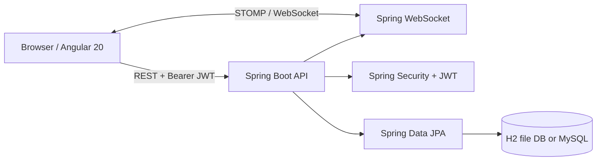

<div align="center">

# WhatsApp Web Clone – Angular 20 + Spring Boot 3 | ChatWave

A full-stack, real-time chat application built with Angular 20,
Java 21, Spring Boot, WebSocket, STOMP, JWT Authentication,
TypeScript and MySQL.

**Angular 20 · TypeScript · Spring Boot 3.5 · Java 21 · JWT · WebSocket · H2 / MySQL**

[](https://angular.dev/)
[](https://spring.io/projects/spring-boot)
[](https://adoptium.net/)
[](https://www.typescriptlang.org/)
[](#license)

An independent, responsive messaging application for learning full-stack engineering, secure REST APIs, and event-driven real-time updates.

[Features](#-features) · [Requirements](#-requirements--tools) · [Installation](#-installation--running-locally) · [API](#-api-reference) · [Troubleshooting](#-troubleshooting) · [Deployment](#-production--deployment-notes)

</div>

> [!IMPORTANT]
> **Disclaimer:** ChatWave is an educational WhatsApp Web–inspired project. It is **not** affiliated with or endorsed by WhatsApp or Meta, does not connect to existing WhatsApp accounts, and does **not** provide WhatsApp-grade end-to-end encryption.

## ✨ Features

| Feature | Status | Description |
| --- | --- | --- |
| Account registration and login | ✅ | Email/password authentication with BCrypt and JWT |
| Responsive chat UI | ✅ | Conversation sidebar, chat panel, and profile drawer |
| Dark and light themes | ✅ | Toggleable UI theme |
| One-to-one messaging | ✅ | Create a direct conversation with a registered user |
| Group conversations | ✅ | Create named chats with multiple registered users |
| Text messages | ✅ | Send and persist messages in the database |
| Real-time chat updates | ✅ | STOMP over WebSocket signals clients to refresh chat data |
| Search | ✅ | Search registered users and filter conversations |
| Unread counts | ✅ | Mark chats as read and display unread counts |
| Profile editing | ✅ | Update display name and about text |
| File attachments, voice notes, calls, statuses | ❌ | Not implemented |
| End-to-end encryption, accurate delivery ticks, live presence | ❌ | Not implemented |

## 🧱 Architecture



## 🛠 Requirements & tools

| Software | Recommended / project version | Required? | Use |
| --- | --- | --- | --- |
| **Node.js** | **20.19+** (or an Angular 20–supported Node 22/24 version) | ✅ | Run/build Angular |
| **npm** | 10+ | ✅ | Install frontend packages |
| **Java JDK** | **21** | ✅ | Compile/run Spring Boot |
| **Apache Maven** | 3.9+ | ✅ | Build backend (`mvn`) |
| **Git** | Recent stable version | ✅ for GitHub | Clone/commit/push source |
| **IDE** | VS Code / IntelliJ IDEA / STS | Optional | Development |
| **MySQL Server** | 8.x | Optional | Persistent relational database instead of H2 |
| **MySQL Workbench** | 8.x | Optional | GUI for MySQL administration |
| **Postman / Bruno** | Recent version | Optional | Test REST endpoints |
| **Chrome / Firefox / Edge** | Modern version | ✅ | Run UI; test different accounts |

### Main dependencies from the project

| Frontend | Version | Backend | Version |
| --- | --- | --- | --- |
| Angular packages + CLI | `~20.3.0` | Spring Boot parent | `3.5.16` |
| TypeScript | `~5.9.0` | Java | `21` |
| RxJS | `~7.8.2` | JJWT | `0.12.6` |
| Zone.js | `~0.15.1` | Spring Security | Managed by Spring Boot |
| `@stomp/stompjs` | `^7.1.1` | Spring WebSocket | Managed by Spring Boot |
| `lucide-angular` | `^0.468.0` | Spring Data JPA | Managed by Spring Boot |
| | | MySQL Connector/J, H2 | Managed by Spring Boot |

> Version notation: `~` accepts compatible patch updates, `^` compatible minor/patch updates, and transitive Spring versions are resolved through the Spring Boot dependency manager. If a `package-lock.json` is committed, prefer `npm ci` for reproducible installs.

### Verify prerequisites

```bash
node --version
npm --version
java -version
mvn -version
git --version
```

Ensure `mvn -version` shows **Java 21**. If it shows another JDK, correct `JAVA_HOME` and your `PATH`.

## 📁 Project structure

```text
chatwave/
├── README.md                     # This file
├── .gitignore
├── frontend/
│   ├── package.json
│   ├── angular.json
│   ├── tsconfig.json
│   └── src/
│       ├── main.ts
│       ├── styles.css
│       └── app/
│           ├── app.component.ts
│           ├── app.component.html
│           ├── app.component.css
│           ├── api.service.ts
│           ├── auth.interceptor.ts
│           └── models.ts
└── backend/
    ├── pom.xml
    └── src/main/
        ├── resources/application.yml
        └── java/com/chatwave/
            ├── ChatwaveApplication.java
            ├── config/
            ├── controller/
            ├── dto/
            ├── model/
            ├── repository/
            └── service/
```

## 🚀 Installation & running locally

### 1. Clone the repository

```bash
git clone https://github.com/<YOUR_USERNAME>/<YOUR_REPOSITORY>.git
cd <YOUR_REPOSITORY>
```

Alternatively, unzip the project and open the root folder in VS Code.

### 2. Start the backend (Terminal 1)

The default database is **H2 file storage**, so you **do not need to install MySQL** for your first run.

**Windows PowerShell:**

```powershell
cd backend
$env:JWT_SECRET = "replace-this-with-a-random-secret-at-least-32-bytes-long"
mvn clean spring-boot:run
```

**macOS / Linux:**

```bash
cd backend
export JWT_SECRET='replace-this-with-a-random-secret-at-least-32-bytes-long'
mvn clean spring-boot:run
```

Spring Boot runs on **http://localhost:8080**. The development H2 database is stored in `backend/data/` and persists between restarts.

> [!CAUTION]
> `JWT_SECRET` examples are placeholders. Generate a cryptographically random secret of at least 32 bytes for real usage; never publish an actual secret. The default `JWT_SECRET` in `application.yml` is for local development only.

### 3. Start the frontend (Terminal 2)

From the repository root:

```bash
cd frontend
npm install
npm start
```

Open **http://localhost:4200**.

Angular runs with `zone.js` listed as a dependency and configured under `angular.json` → `polyfills`. If you encounter `NG0908`, ensure dependencies are installed and `zone.js` is present in polyfills.

### 4. Register users and start chatting

1. Register account A using the registration screen.
2. Open an incognito/private window or a different browser and register account B with **another email**.
3. In account A, click **New Chat**, search account B by name, and select the result.
4. Send a text message. In account B, open the conversation and reply.
5. Confirm the chat updates in both browser windows while the backend is running.

**No demo account is pre-created**; credentials are whatever you choose during registration.

## 🗄 Optional: use MySQL 8 instead of H2

In MySQL Workbench or the MySQL CLI, execute:

```sql
CREATE DATABASE chatwave CHARACTER SET utf8mb4 COLLATE utf8mb4_unicode_ci;
CREATE USER 'chatwave'@'localhost' IDENTIFIED BY 'replace-with-strong-password';
GRANT ALL PRIVILEGES ON chatwave.* TO 'chatwave'@'localhost';
```

Then configure environment variables **before** running Spring Boot.

**Windows PowerShell:**

```powershell
$env:DB_URL = "jdbc:mysql://localhost:3306/chatwave?useSSL=false&serverTimezone=UTC"
$env:DB_USERNAME = "chatwave"
$env:DB_PASSWORD = "YOUR_LOCAL_MYSQL_PASSWORD"
$env:JWT_SECRET = "YOUR_LONG_RANDOM_JWT_SECRET"
$env:CORS_ORIGIN = "http://localhost:4200"
mvn spring-boot:run
```

**macOS / Linux:**

```bash
export DB_URL='jdbc:mysql://localhost:3306/chatwave?useSSL=false&serverTimezone=UTC'
export DB_USERNAME='chatwave'
export DB_PASSWORD='YOUR_LOCAL_MYSQL_PASSWORD'
export JWT_SECRET='YOUR_LONG_RANDOM_JWT_SECRET'
export CORS_ORIGIN='http://localhost:4200'
mvn spring-boot:run
```

The current `spring.jpa.hibernate.ddl-auto=update` creates/updates development tables automatically. Use versioned database migrations (such as Flyway) for production.

### Configuration reference

| Environment variable | Default | Description |
| --- | --- | --- |
| `PORT` | `8080` | Backend HTTP port |
| `DB_URL` | `jdbc:h2:file:./data/chatwave;DB_CLOSE_ON_EXIT=FALSE` | JDBC connection URL |
| `DB_USERNAME` | `sa` | Database username for H2 |
| `DB_PASSWORD` | empty | Database password for H2 |
| `JWT_SECRET` | insecure development fallback | JWT signing secret; replace before deployment |
| `CORS_ORIGIN` | `http://localhost:4200` | Allowed Angular origin in original project configuration |

**CORS note:** If using the updated `SecurityConfig.java` from the CORS fix, localhost origins are explicitly configured there. Keep backend CORS settings in sync with the Angular URL. For deployment, use only approved production origins.

## 🔌 API reference

REST base URL: **`http://localhost:8080/api`**

| Method | Endpoint | Purpose | Auth |
| --- | --- | --- | --- |
| `POST` | `/auth/register` | Create account | No |
| `POST` | `/auth/login` | Login and receive token | No |
| `GET` | `/me` | Load profile | JWT |
| `PUT` | `/me` | Update display name/about | JWT |
| `GET` | `/users?q=...` | Search registered users | JWT |
| `GET` | `/chats` | List conversations | JWT |
| `POST` | `/chats` | Create direct or group chat | JWT |
| `GET` | `/chats/{id}/messages` | Load latest 200 messages | JWT |
| `POST` | `/chats/{id}/messages` | Send text | JWT |
| `POST` | `/chats/{id}/read` | Mark chat read | JWT |

Authenticated requests use `Authorization: Bearer <token>`.

### Register example

```bash
curl -i -X POST http://localhost:8080/api/auth/register \
  -H 'Content-Type: application/json' \
  -d '{"name":"Demo User","email":"demo@example.com","password":"CHANGE_ME_STRONG_PASSWORD"}'
```

This example uses a POSIX shell. For Windows PowerShell, use `curl.exe` with correctly escaped JSON or use Postman.

### WebSocket events

- URL: `ws://localhost:8080/ws`
- Protocol: **STOMP**
- STOMP `CONNECT` header: `Authorization: Bearer <token>`
- Subscribe to: `/user/queue/events`
- Purpose: trigger REST refresh when a conversation changes; the application does **not** send complete message content exclusively over WebSocket.

## 🧪 Verification & builds

**Frontend:**

```bash
cd frontend
npm install
npm run typecheck
npm run build
```

**Backend:**

```bash
cd backend
mvn clean package
```

This repository currently does not ship a comprehensive automated test suite. The commands above validate type-checking, compilation, and packaging, but should not be treated as proof that every feature is production-ready.

## 🧯 Troubleshooting

<details>
<summary><strong>Angular NG0908: Zone.js is required</strong></summary>

Run `npm install`, confirm `zone.js` is in `frontend/package.json`, and confirm `angular.json` contains `"polyfills": ["zone.js"]`. Restart `npm start`.
</details>

<details>
<summary><strong>CORS blocks /api/auth/register or /api/auth/login</strong></summary>

Ensure the Spring Security `SecurityFilterChain` enables CORS, allows `OPTIONS /**`, and permits `/api/auth/**` without authentication. The origin must match exactly (for example `http://localhost:4200`). Restart Spring Boot. Look at the Network tab for the preflight response.
</details>

<details>
<summary><strong>Failed to connect to localhost:8080</strong></summary>

Run the backend first; confirm Spring Boot started on port 8080 and no other process is using it. The Angular REST URL is hard-coded in `frontend/src/app/api.service.ts`.
</details>

<details>
<summary><strong>Messages do not refresh live</strong></summary>

Check the browser Network → WS connection to `ws://localhost:8080/ws`, the STOMP auth token, backend logs, and whether both accounts are members of the conversation. The frontend also requires a running REST API to fetch updates.
</details>

<details>
<summary><strong>MySQL authentication / connection failure</strong></summary>

Ensure MySQL Server is running and check `DB_URL`, `DB_USERNAME`, `DB_PASSWORD`, privileges, and database name. Omit custom MySQL settings to return to H2 during initial setup.
</details>

<details>
<summary><strong>Maven compile failure or wrong Java version</strong></summary>

Confirm `java -version` **and** `mvn -version` report Java 21; reinstall dependencies and use `mvn clean package` from `backend/`.
</details>

## 🔒 Security considerations

- Passwords are hashed using BCrypt; JWTs are used for API authentication.
- The example frontend stores its JWT in `localStorage`. This is convenient for a demo but exposes tokens to XSS risk; improve the token strategy before production.
- Secure WebSocket authentication/authorization at every relevant destination and validate conversation membership for every request.
- Add login throttling, email verification, CSRF review if cookie auth is introduced, audit logs, server-side validation, and automated security testing.
- **Do not** store private secrets, database files, `node_modules`, or build outputs in Git.
- The project is **not** end-to-end encrypted and must not be presented as a secure WhatsApp replacement.

## 🌍 Production & deployment notes

1. Build Angular with `npm run build` and deploy the static output to a static host (e.g. Netlify or Vercel), configuring SPA rewrites if required.
2. Package Spring Boot with `mvn clean package` and run it on a JVM host with **Java 21**, HTTPS, and a production database.
3. Replace hard-coded URLs in `frontend/src/app/api.service.ts` (`http://localhost:8080/api`) and `frontend/src/app/app.component.ts` (`ws://localhost:8080/ws`) with environment-based `https://` / `wss://` endpoints.
4. Set a production `JWT_SECRET`, database credentials, and strict CORS origins via host environment variables.
5. Add proper database migrations, rate limiting, monitoring, backups, and CI tests before public launch.

## ⬆️ Upload to GitHub

From the **repository root** (the folder containing `frontend/` and `backend/`):

```bash
git init
git add .
git commit -m "docs: add full-stack ChatWave setup and project guides"
git branch -M main
git remote add origin https://github.com/<YOUR_USERNAME>/<YOUR_REPOSITORY>.git
git push -u origin main
```

If your repo is already initialized or a remote already exists, **skip** `git init` and `git remote add origin`; use normal `git add`, `git commit`, and `git push` instead.

### Suggested repository metadata

**Description:** `ChatWave – Real-Time WhatsApp Web Inspired Chat App built with Angular 20, Spring Boot, Java 21, JWT, WebSocket and MySQL.`

**Topics:** `angular`, `angular20`, `spring-boot`, `java`, `typescript`, `websocket`, `stomp`, `jwt`, `chat-application`, `real-time-chat`, `whatsapp-clone`, `mysql`, `full-stack`.

## 🗺 Roadmap

- [ ] Images, documents and secure media storage
- [ ] Per-message delivered/read receipts
- [ ] Typing indicators and presence
- [ ] Emoji reactions, reply/forward and message pagination
- [ ] Voice notes and WebRTC voice/video calls
- [ ] Push notifications and multi-device support
- [ ] Comprehensive automated testing and deployment pipeline

## 🤝 Contributing

Issues and pull requests are welcome. Please avoid committing secrets, `.env` files, local databases, or generated build folders.

## 📄 License

**No license has been selected yet.** Add a `LICENSE` file (for example MIT, if appropriate) before describing this repository as open-source or allowing broad reuse.

---

<div align="center">

Built for learning modern **Angular + Spring Boot** full-stack development.

**ChatWave is an independent educational project, not an official WhatsApp product.**

</div>
